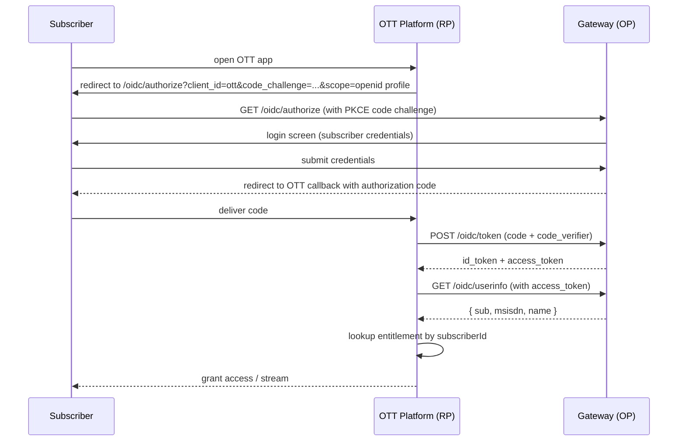
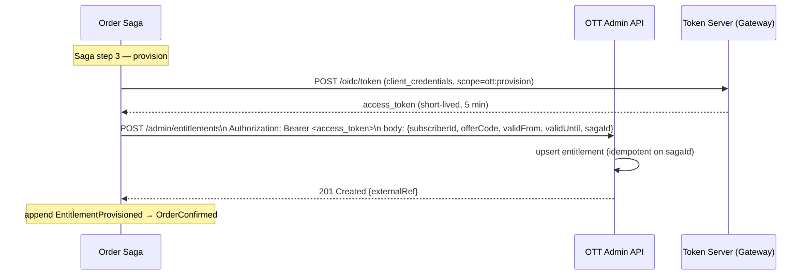

# OTT Platform — Auth & Integration Design

## The two problems (distinct, often conflated)

| Problem | Question | Solution |
|---|---|---|
| **Federated login** | How does a subscriber authenticate *to the OTT platform* using their telco identity? | OIDC — Authorization Code + PKCE |
| **Entitlement provisioning** | How does VA-BAGS tell the OTT platform that a subscriber has purchased access? | REST API call from Order Saga, secured by OAuth2 client credentials |

These are independent flows. Conflating them (e.g., trying to provision via the user's access token) is a common design mistake.

---

## Why OIDC, not plain OAuth2 or SAML

| Option | Verdict | Reason |
|---|---|---|
| SAML | Skip | XML-heavy, browser-redirect-only, designed for enterprise workforce IdPs. Clunky for consumer mobile-first scenario. |
| Plain OAuth2 | Insufficient | Delegated *authorization* only — says nothing about who the user is. |
| **OIDC (OAuth2 + identity layer)** | **Chosen** | Adds `id_token` (JWT proving identity) on top of OAuth2. Standard consumer SSO pattern. Telco = OpenID Provider (OP). OTT = Relying Party (RP). |

**Flow: Authorization Code + PKCE**
- PKCE because mobile/public clients cannot safely store a client secret.
- Code flow (not implicit) because tokens are never exposed in the browser URL fragment.

---

## OIDC login flow (subscriber → OTT)



**id_token claims:**
```json
{
  "sub": "sub_...",
  "msisdn_hash": "sha256(msisdn)",
  "name": "Subscriber Name",
  "iss": "https://vab.example.com",
  "aud": "ott-client-id",
  "iat": 1234567890,
  "exp": 1234571490
}
```
`msisdn` is hashed in the token — OTT does not get raw MSISDN unless explicitly scoped.

---

## Entitlement provisioning flow (Order Saga → OTT)

> **Superseded by §8 below** (API key + async activation + webhooks). Kept for history: this was the
> original OAuth2 client-credentials design.



Token is cached in the Saga adapter for its lifetime. Not re-fetched per request.

**Compensation (revoke):**
```
DELETE /admin/entitlements/{externalRef}
Authorization: Bearer <access_token>
```
Idempotent — returns `200` even if already revoked.

---

## OTT platform scope (what it does and doesn't do)

**Does:**
- Serve a small video catalog (title, description, stream URL).
- `GET /v1/videos` — search/browse.
- `GET /v1/videos/{id}/stream` — returns stream URL, gated on local entitlement check.
- Maintain local entitlement table: `(subscriberId, offerCode, status, validFrom, validUntil, externalRef)`.

**Does not:**
- Manage subscriber identity (only OIDC RP).
- Handle payments.
- Know about VA-BAGS internals.

---

## Implementation note

**Self-hosted Keycloak** is the OIDC OP (DD-29) — a full open-source IdP (realms, user store + self-service registration, login/consent UI, credential flows, admin console) behind standard OIDC discovery/JWKS, not a hand-rolled JWT issuer. **`api-gateway` is not the OP**: it stays **Spring Cloud Gateway** as the edge resource server that validates Keycloak-issued tokens and relays them downstream. The OP endpoints are therefore Keycloak's realm endpoints (`/realms/vab/protocol/openid-connect/{auth,token,userinfo,certs}` + discovery), not `/oidc/*` on the gateway — the flows sketched above are unchanged in shape; only the OP host differs.

### As-built (§A-2)

ott-service is a backend with no video UI, so it plays the RP as a **server-side Spring `oauth2Login` client** rather than a SPA:

- **Login** — public Keycloak client `vab-ott` (Authorization Code + **PKCE**, `S256`). The browser hits any `/v1/videos/**` path, Spring redirects to Keycloak, and the callback (`/login/oauth2/code/keycloak`) establishes a **session**. No client secret (public client ⇒ Spring auto-applies PKCE).
- **Identity → entitlement** — the `subscriberId` claim (Keycloak *user-attribute* mapper) identifies the subscriber; streaming is gated against ott-service's own `entitlements` table (`existsBySubscriberIdAndOfferCodeAndStatus(…, ACTIVE)`). The seeded demo user `alice` carries `subscriberId=sub-alice`.
- **Video surface** — `GET /v1/videos` lists a seeded catalog; `GET /v1/videos/{id}/stream` returns **`"Playing video: <title>"`** when entitled, **403** otherwise, **404** for an unknown id. There is no real media — "stream" is a success message.
- **Two filter chains** — the §A-1 provisioning API (`/ott/v1/entitlements/**`) stays a **Bearer resource server** (`@Order(1)`); the subscriber surface is the **login client** (`@Order(2)`). One service, both OAuth2 roles.

The provisioning flow (Order Saga → OTT) is unchanged — it remains the client-credentials path from §A-1/A-4 (the live route is `POST /ott/v1/entitlements`, not `/admin/entitlements`).

---

## 8. Partner API with API key and webhooks (current design, 2026-11)

Real OTT platforms don't federate with each partner's identity provider: they issue the partner an **API key**,
expose an entitlement API, and report state changes with **signed webhooks**. VA-BAGS now works the same way.
The subscriber's OIDC login to the OTT video surface (above) is unchanged. The Keycloak client
`vab-provisioning` stays in the realm but nothing uses it.

```
fulfilment ──POST /ott/v1/entitlements (X-Api-Key)──▶ ott-service
           ◀── 202 {externalRef, status: PENDING} ────
                                                     activator, ~2 s later: PENDING → ACTIVE (or REJECTED)
                                                     outbox row + webhook in the same transaction
fulfilment ◀── POST /webhooks/ott  Ott-Signature: t=…,v1=hex(HMAC-SHA256(secret, t + "." + body)) ── retried
           saga gets OrderFulfilled (activated) or OrderFulfilmentFailed(PROVISIONING_REJECTED) (rejected)
```

| Concern | How |
|---|---|
| **Authn, partner → OTT** | `X-Api-Key` (constant-time compare; one partner key, from `vabags-secrets` → `VAB_OTT_API_KEY`). Wrong or missing: 401 before any controller. |
| **Authn, OTT → partner** | HMAC-signed webhook (`VAB_OTT_WEBHOOK_SECRET`); fulfilment verifies the raw body, ±5 min replay window, dedupes on the event id (`fulfilment.ott_webhook_event`). Several `v1` values allowed for secret rotation. |
| **Provisioning** | `POST` → **202 PENDING**. Idempotent on `orderId`: a repeat returns the current state (`ACTIVE` with validity, `REJECTED` with reason). 422 (OTTBAD) and 503 (OTTDOWN) stay synchronous. |
| **Activation** | `EntitlementActivator` (every 1 s) activates PENDING rows older than `ott.activation-delay` (2 s). Demo trigger: an offer code containing `OTTREJECT` is rejected here → `entitlement.rejected`. |
| **Delivery** | `ott.webhook_events` outbox → `WebhookDelivery` (every 1 s, `FOR UPDATE SKIP LOCKED`), doubling backoff capped at 1 min, FAILED after 20 attempts. |
| **Fulfilment waiting** | New provisioning-task state **AWAITING_ACTIVATION** holds the saga's reply token (Design/13 §6). The deadline (2 h) and a user cancel apply as before: refund, and the entitlement is revoked by order. |
| **Late activation** | An activation for an order that already timed out / was cancelled is revoked (`REVOKE_OWED`). |
| **Uncertain POST** | A timed-out POST stays RETRYING; if OTT did accept it, its activation webhook still completes the order, and a retried POST returns the existing entitlement. |
| **Revoke** | `DELETE /ott/v1/entitlements/{ref}` and `/by-order/{orderId}`, API key, synchronous 204 (unchanged semantics). |

